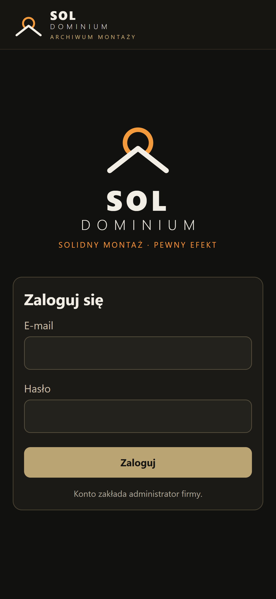
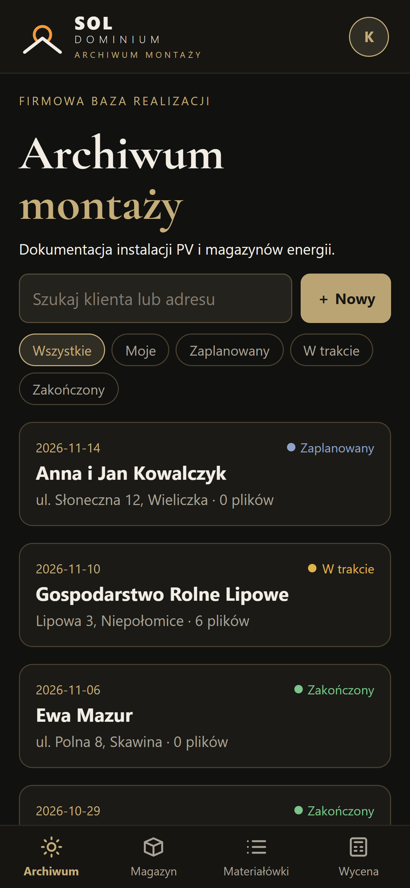
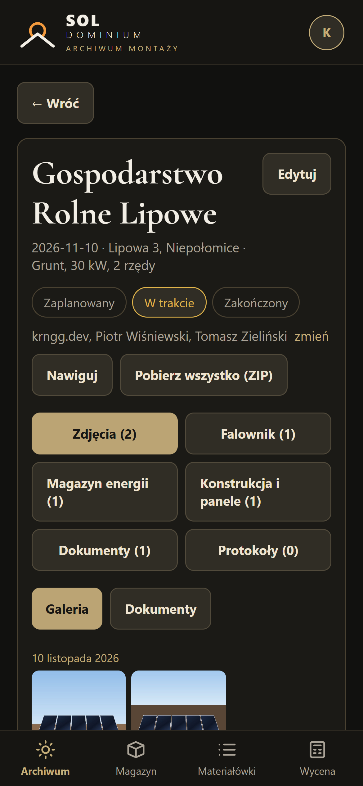
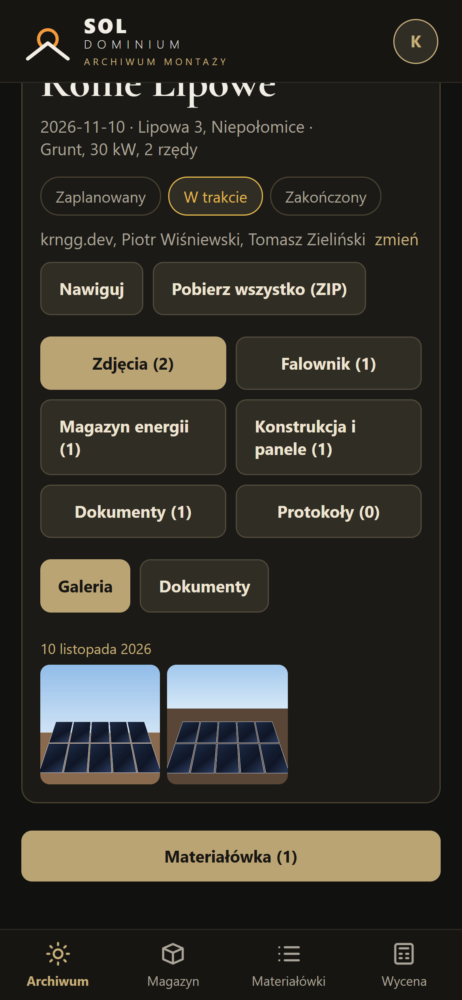
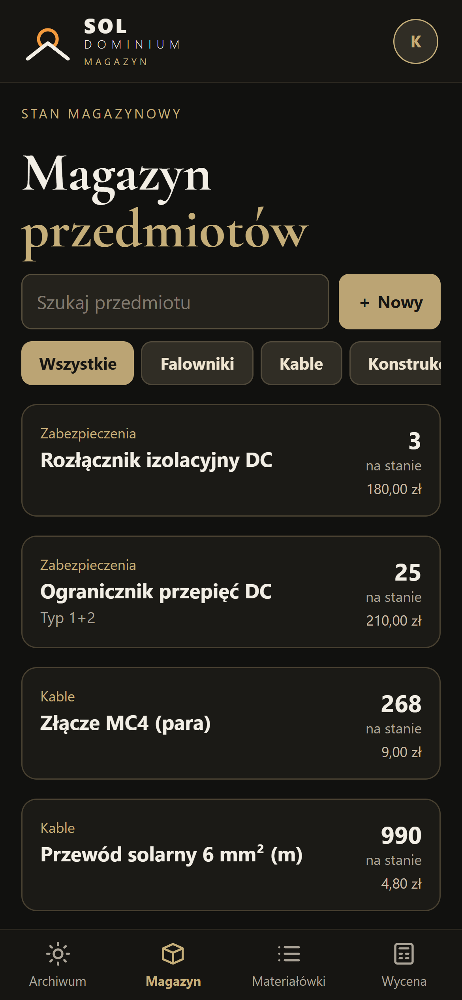
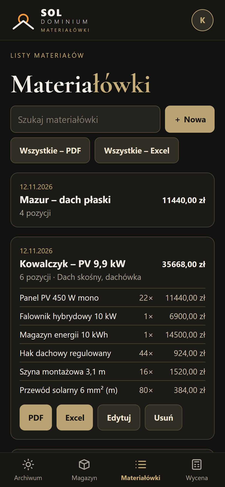
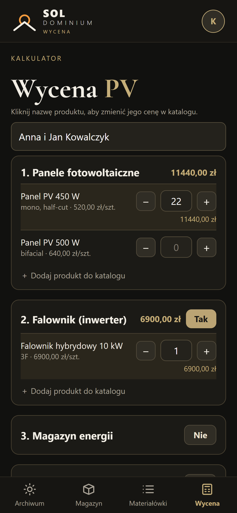
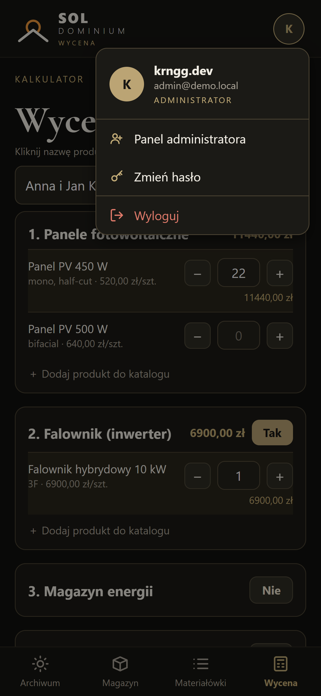
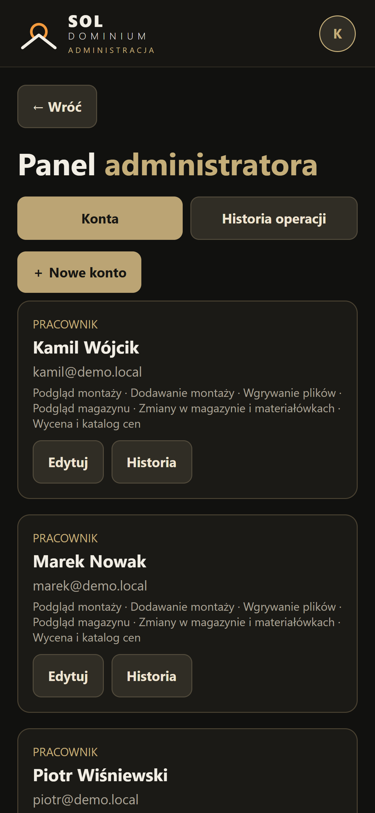

  

<h1 align="center">solApp</h1>

  Prywatna aplikacja mobilna dla firmy <a href="https://soldominium.pl"><b>SOL DOMINIUM</b></a>, dla ekip montujących instalacje fotowoltaiczne i magazyny energii. 
  Android i iOS · projekt i wykonanie: <b>krngg.dev</b>

---

## O projekcie

solApp to wewnętrzne narzędzie firmy [SOL DOMINIUM](https://soldominium.pl), która zajmuje się instalacjami fotowoltaicznymi i magazynami energii. Zastępuje papierowe protokoły, zdjęcia rozrzucone po telefonach i arkusze z magazynem. Monter ma w jednej aplikacji montaże, dokumentację zdjęciową, stany magazynowe, listy materiałów i kalkulator wyceny. Biuro widzi wszystko na bieżąco.

Aplikacja jest prywatna i działa tylko na kontach zakładanych przez administratora. Kod źródłowy nie jest publiczny.

> Zrzuty ekranu pokazują wersję demonstracyjną ze zmyślonymi danymi.

## Montaże

  
  
  

- Archiwum realizacji z wyszukiwaniem po kliencie i adresie
- Statusy: zaplanowany, w trakcie, zakończony, oraz filtr „Moje”
- Przypisywanie monterów do montażu
- Nawigacja do adresu jednym kliknięciem
- Zdjęcia i dokumenty w kategoriach: falownik, magazyn energii, konstrukcja, protokoły
- Lokalizacja GPS i czas wykonania przy każdym zdjęciu
- **Praca bez zasięgu:** zdjęcia czekają w kolejce i wysyłają się same, gdy wróci internet
- Pobranie całego montażu jednym plikiem ZIP

## Magazyn i materiałówki

  
  

- Stany magazynowe z kategoriami, cenami i skanowaniem kodów QR
- Materiałówki, czyli listy materiałów na konkretną instalację, które od razu zdejmują towar ze stanu
- Przypinanie materiałówki do montażu
- Eksport każdej listy osobno albo wszystkich naraz, do **PDF** i **Excela**

## Wycena

  

- Kalkulator instalacji PV podzielony na sekcje: panele, falownik, magazyn energii, zasilanie awaryjne, konstrukcja, rozdzielnie i przewody
- Własny katalog produktów i cen, edytowany z poziomu aplikacji
- Suma netto, VAT i brutto
- Gotowa wycena w PDF dla klienta

## Administracja

  
  

- Konta pracowników z uprawnieniami nadawanymi pojedynczo
- Historia operacji: kto, co i kiedy dodał, zmienił albo pobrał
- Codzienna automatyczna kopia zapasowa bazy i plików

## Technologie

| Część | Stos |
| --- | --- |
| Aplikacja | Expo, React Native, TypeScript |
| Serwer | Node.js, Express, JWT |
| Baza danych | MongoDB |
| Dystrybucja | EAS Build, aktualizacje OTA przez EAS Update |

---

© krngg.dev. Wszelkie prawa zastrzeżone.

